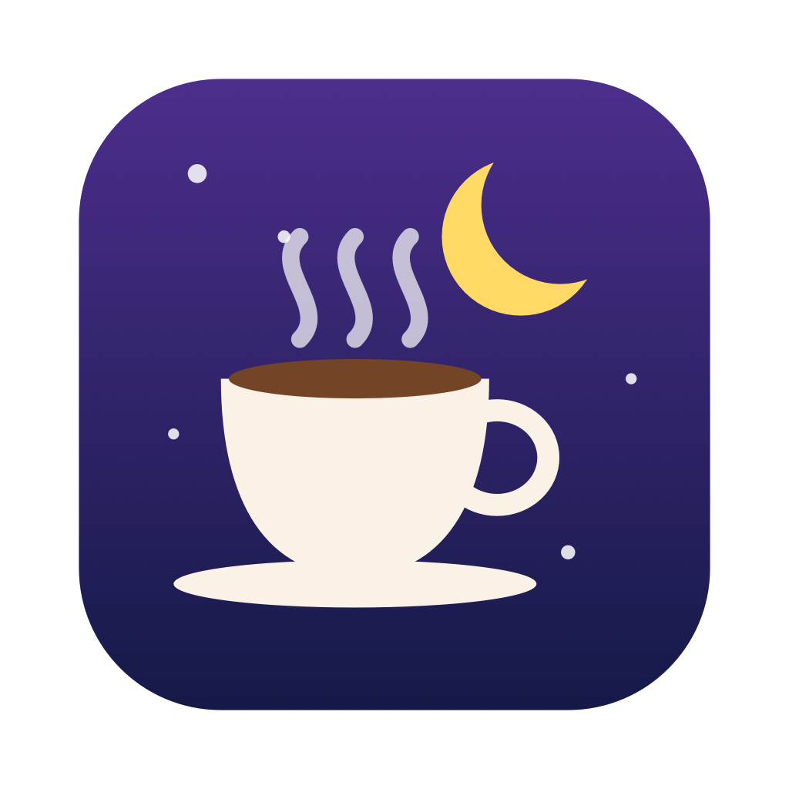

<p align="center"></p>

# NoSleep

A tiny macOS menu bar app that keeps your Mac awake, **even when you close the lid**.

## Why
Normal "keep awake" tools (`caffeinate`, assertion-based apps) stop working when the lid is closed.
NoSleep flips the system-wide `pmset disablesleep` flag, which is the only reliable way to keep a
Mac running in clamshell mode without an external display.

## Features
- Click the menu bar icon: an on/off switch at the top, options below (☕ = ON, never sleeps · 🌙 = OFF, normal sleep)
- Works with the lid closed, on battery or power
- The setting stays on after you quit the app or restart, until you turn it off
- Optional **Open at Login**

## Build & install
Requires Xcode Command Line Tools (macOS 13+).

```sh
./build.sh
cp -R NoSleep.app /Applications/
open /Applications/NoSleep.app
```

Turning the setting on or off asks for your admin password.

## Turn sleep back on manually
```sh
sudo pmset -a disablesleep 0
```

## ⚠️ Heads-up
With the lid closed the Mac keeps running. Don't put it in a bag while NoSleep is on; it can overheat and drain the battery.

## Regenerate the icon
```sh
swift tools/make_icon.swift /tmp/AppIcon.iconset && iconutil -c icns /tmp/AppIcon.iconset -o AppIcon.icns
```
